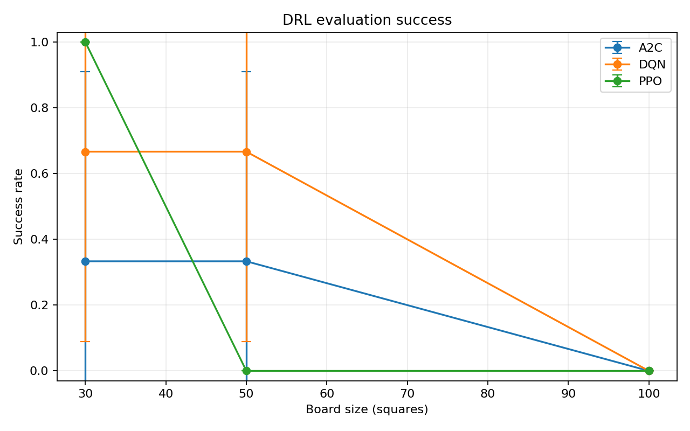
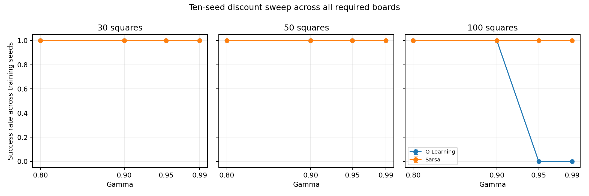
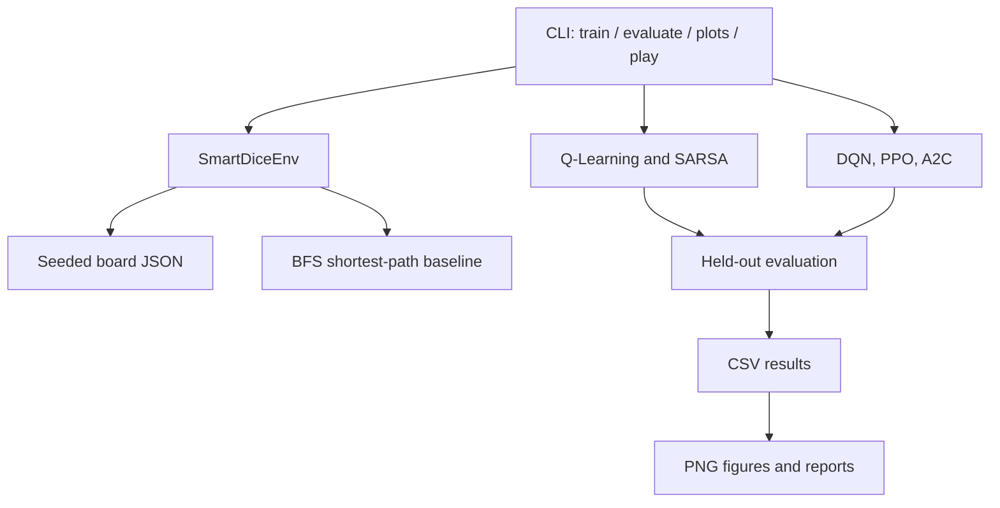

# Smart Dice Board Game — Reinforcement Learning

Course project implementing a controllable-dice snakes-and-ladders game as a [Gymnasium](https://gymnasium.farama.org/) environment. The agent chooses one of six dice values. The project compares tabular Q-Learning and SARSA with Stable-Baselines3 DQN, PPO, and A2C, and measures them against random play and BFS.

**Stack:** Python · Gymnasium · Stable-Baselines3 · PyTorch · NumPy · pandas · matplotlib  
**Status:** complete experimental project; original and supplemental results are preserved separately.  
**Report:** [PDF](docs/final_report.pdf) · [Word](docs/final_report.docx) · [Markdown](docs/final_report.md)

## Results at a glance

| Experiment | Measured result |
|---|---|
| Original 30- and 50-square boards | Tabular Q-Learning and SARSA: 100% success, 3 moves, matching BFS |
| Original 100-square board | All learned methods: 0% success at the initial training budgets |
| Ten-seed gamma sweep, 100 squares | Q-Learning solved 10/10 seeds at γ=.80/.90; SARSA solved 10/10 at γ=.80/.90/.95/.99; successful routes averaged 10–10.1 moves vs BFS 9 |
| Goal-focused reward variant, 100 squares | Q-Learning: 100% success and 9 moves in the three tested seeds; this is a separate reward objective |
| Held-out 100-square DRL generalization | Best multi-board result was DQN at 11.1%; transfer was not reliable |
| Random baseline, 100-square fixed board | 9,999 wins in 10,000 episodes (99.99%) on this particular layout |

The confidence interval for 10/10 gamma-sweep successes is a Wilson 95% interval of [72.2%, 100%] over independent **training seeds**. It does not guarantee success on other boards. Repeated runs of the same deterministic policy are not treated as independent samples. See the report and raw CSVs for full results, failures, reward values, and uncertainty.






## Features

- Custom deterministic Gymnasium environment with seeded board generation, validation, text rendering, and documented overshoot handling.
- Three required fixed boards (30/3/3, 50/5/5, 100/8/8), plus generated boards for cross-layout tests.
- Tabular Q-Learning and SARSA; SB3 DQN, PPO, and A2C.
- Random and BFS baselines, saved policy evaluation, convergence checkpoints, and diagnostic plots.
- Separate experiments for longer budgets, discount-factor sensitivity, reward variants/cycle diagnosis, DRL tuning, and multi-board generalization.
- Saved model files for the five original board-1 demo policies. Full research models and checkpoints remain in the local workspace and are excluded from the GitHub release.

## Architecture

The package remains at the repository root so existing `python -m smart_dice_rl ...` imports keep working.



## Algorithms

- **Q-Learning:** off-policy temporal-difference control; updates toward the best estimated next action.
- **SARSA:** on-policy temporal-difference control; updates using the next action actually selected by the exploratory policy.
- **DQN:** deep action-value learning with replay memory, target network, and epsilon-greedy exploration.
- **PPO:** on-policy actor-critic learning with a clipped policy objective.
- **A2C:** synchronous actor-critic learning using advantage estimates.

For a fully known deterministic board and a shortest-path objective, BFS is simpler and gives the shortest route. RL is included to study learning from interaction, reward objectives, stochastic transitions, and changing/unknown board layouts.

## Installation

Requires Python 3.10 or later. Use a virtual environment. These commands install the dependencies and version constraints declared in `requirements.txt`.

### Windows PowerShell

```powershell
py -3.12 -m venv .venv
.\.venv\Scripts\Activate.ps1
python -m pip install --upgrade pip
python -m pip install -r requirements.txt
```

### Linux / macOS

```bash
python3 -m venv .venv
source .venv/bin/activate
python -m pip install --upgrade pip
python -m pip install -r requirements.txt
```

The project has no `pyproject.toml` or setup package: run module commands from the repository root. Stable-Baselines3 uses CPU by default in the included scripts.

## Run the project

Run all tests:

```bash
pytest -q
```

Train the complete baseline suite (Q-Learning, SARSA, DQN, PPO, A2C on each board and seed):

```bash
python -m smart_dice_rl train
```

This baseline command writes to `models/` and `results/csv/`; it regenerates baseline outputs at those paths. Keep a copy of existing output before rerunning if you want to preserve the current completed run.

Evaluate the baseline saved policies, regenerate baseline plots, and demonstrate random plus learned play:

```bash
python -m smart_dice_rl evaluate
python -m smart_dice_rl plots
python -m smart_dice_rl play --board board_1_30 --algorithm q_learning --seed 17
python -m smart_dice_rl play --board board_1_30 --algorithm sarsa --seed 17
python -m smart_dice_rl play --board board_1_30 --algorithm DQN --seed 17
python -m smart_dice_rl play --board board_1_30 --algorithm PPO --seed 17
python -m smart_dice_rl play --board board_1_30 --algorithm A2C --seed 17
```

The CLI does not expose per-algorithm training flags; `train` runs all five algorithms together under the common baseline setup. The five `play` commands use the corresponding saved policies.

Run the separate supplemental experiments (each writes to its own `results/improved/` and `models/improved/` subdirectory):

```bash
python -m smart_dice_rl.gamma_sweep
python -m smart_dice_rl.gamma_sweep_all_boards
python -m smart_dice_rl.reward_experiments
python -m smart_dice_rl.run_generalization
python -m smart_dice_rl.drl_tuning
python -m smart_dice_rl.final_plots
```

The earlier 100-square extended-budget pilot is a distinct study, also kept separate from the main baseline:

```bash
python -m smart_dice_rl.improve_100
python -m smart_dice_rl.gamma_sweep_100
python -m smart_dice_rl.select_improved_checkpoints
```

Run the original baseline audit after generating the baseline models and the earlier 100-square pilot artifacts. The complete archive reconciliation additionally requires the full model archives produced by every supplemental study; the compact GitHub release intentionally includes only five demo policies.

```bash
python -m smart_dice_rl.final_audit
python -m smart_dice_rl.finalize_outputs
```

## Reproducibility and evaluation

Baseline board definitions, seeds, episode/timestep budgets, and checkpoint criterion are in `config/experiments.json`. Each fixed-board algorithm uses the same board and reward rules. Baseline training uses seeds 17, 29, and 41; evaluation takes place in fresh environments and does not update the policy. Checkpoint validation and final evaluation are distinct. A deterministic policy on a fixed deterministic board repeats the same route, so across-seed and across-board variation—not repeated policy rollouts—is used to describe learning variability.

Supplemental studies have their own configuration and result directories. The ten-seed gamma study uses seeds 301, 307, 311, 313, 317, 331, 337, 347, 349, and 353 at γ=.80/.90/.95/.99. Reward experiments change the objective and must not be pooled with original-reward results. The board-generalization extension uses a 202-value board-aware observation; the original one-value integer observation is unchanged.

## Repository map

```text
smart-dice-board-game-rl/
├── README.md
├── RELEASE_NOTES.md
├── requirements.txt
├── config/                  # baseline experiment settings
├── data/generated_boards/   # seeded fixed board JSON
├── docs/                    # compliance, methodology, reports, research notes
├── models/                  # five small baseline demo policies + model notes
├── report/                  # source report and Word rendering script
├── results/
│   ├── csv/                 # original baseline CSVs
│   ├── plots/               # original comparison figures
│   ├── audit/               # original independent audit evidence
│   ├── improved/             # supplemental experiment CSVs and figures
│   └── final_audit/          # policy, CSV, and reproduction audit
├── smart_dice_rl/           # environment, agents, experiments, CLI
└── tests/
```

## Limitations

The original 100-square baseline did not solve within its initial budget. Lower-gamma tabular policies solved the fixed 100-square layout, but were one move above BFS on average. DRL generalization to held-out 100-square layouts remained weak under the tested CPU budgets. The random baseline is unusually strong on the one saved 100-square map and should not be generalized to unseen layouts. Potential-based shaping has a finite-horizon truncation caveat discussed in the report.

## Academic context and references

Prepared for a university Reinforcement Learning course project. Assignment requirements were checked against the supplied source document; the assignment file itself is not redistributed here. See [assignment compliance](docs/assignment_compliance.md), [methodology](docs/methodology.md), [software versions](docs/software_versions.md), and [environment research](docs/environment_research.md). References and source links are listed in the final report.
