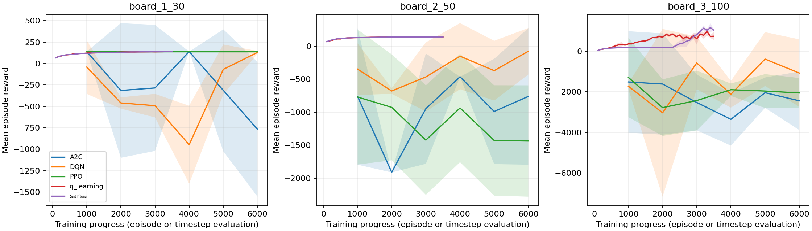
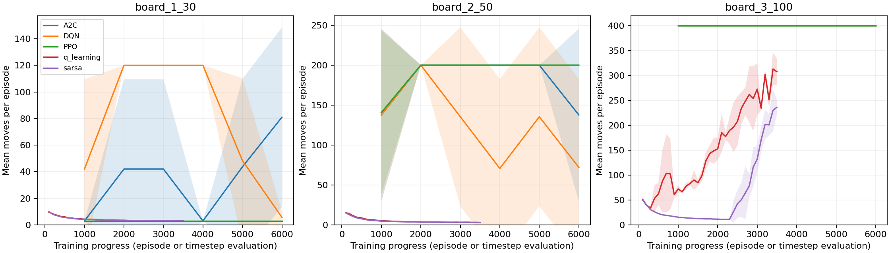
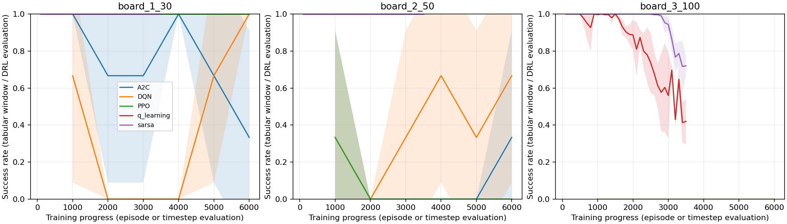
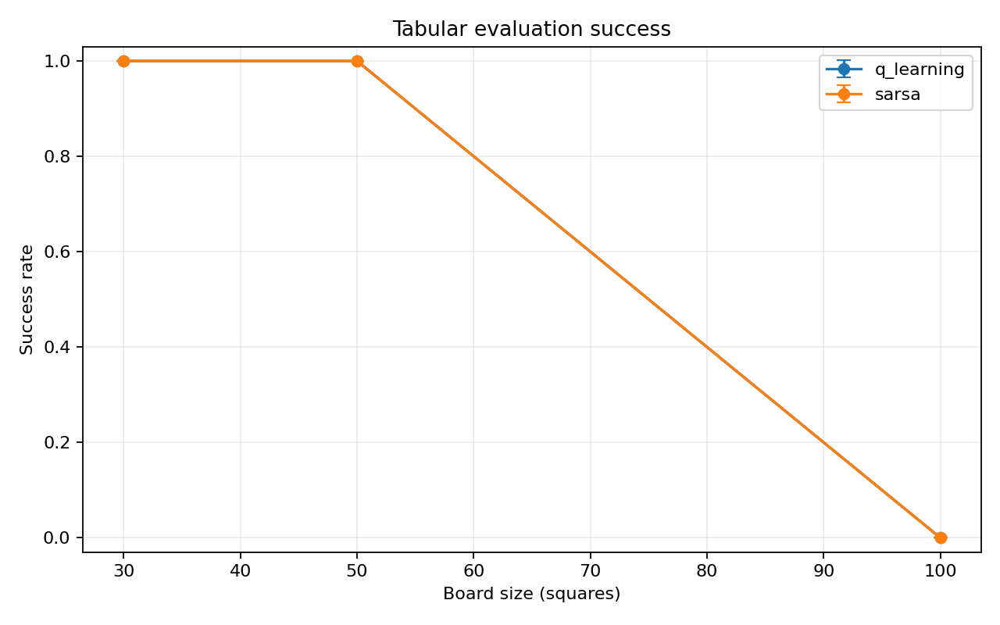
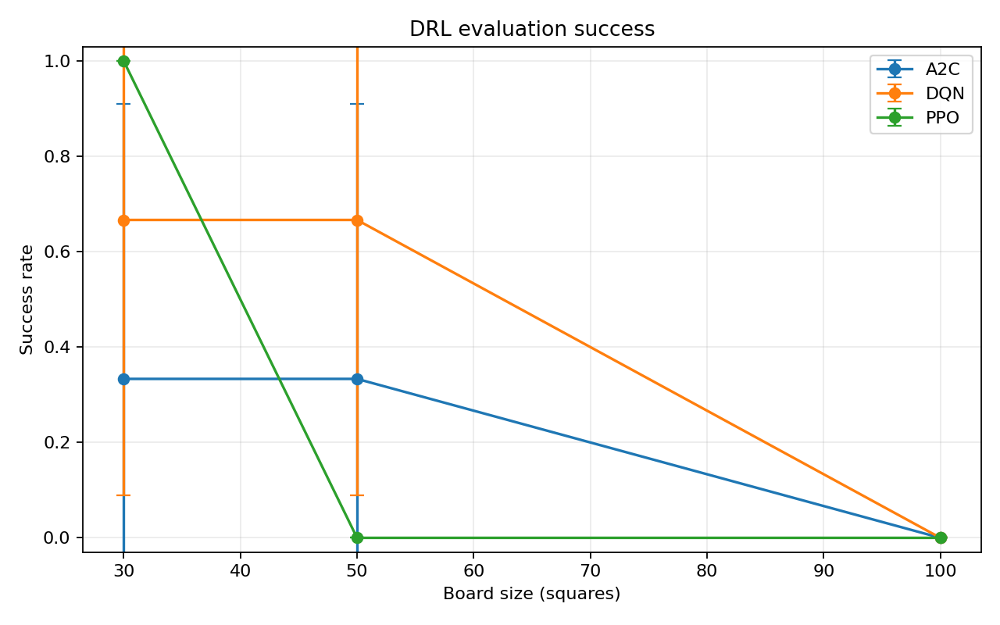
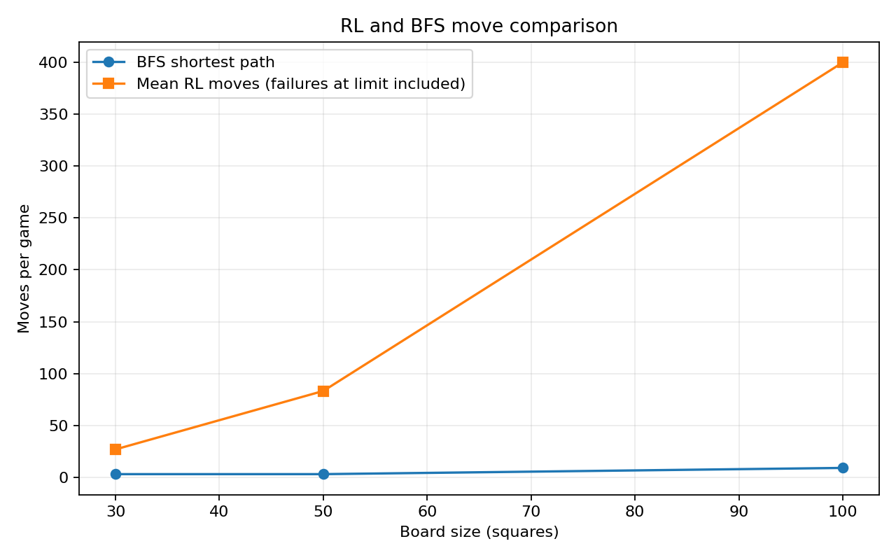
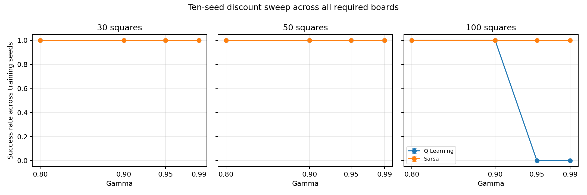

# Smart Dice Board Game Reinforcement Learning Final Report

**Reinforcement Learning Course Project**  
**Experimental report**

## Abstract

This project implements a deterministic, controllable-dice snakes-and-ladders game as a Gymnasium environment and compares five reinforcement learning methods. Tabular Q-Learning and SARSA, plus Stable-Baselines3 DQN, PPO, and A2C, were trained on three fixed seeded boards. Results below are measured from the saved training and held-out evaluation runs. The 30- and 50-square boards were solved consistently by tabular methods; performance became substantially less reliable on 100 squares at the initial training budgets.

## 1. Objective and problem formulation

The player starts at square 1 and seeks square N. On each turn the agent selects one of six dice values, so the control action is the die outcome. A transition advances by that value unless it overshoots; landing on a snake or ladder applies exactly one immediate transition. An episode terminates at the goal or truncates at four times the board size.

### Markov decision process

- **States:** S = {1, …, N}, represented as a one-element integer observation. The current square contains all information needed to determine the next state and reward because each board is fixed within a run and transitions depend only on current position and chosen action. Thus the Markov property holds.
- **Actions:** A = {0, …, 5}; action a corresponds to dice value a+1.
- **Transition:** target = state + action + 1. If target > N, state stays unchanged. Otherwise a snake/ladder mapping at the target is applied once.
- **Reward:** +100 on goal (terminal precedence); +20 after a ladder; −20 after a snake; −1 on a normal move; −10 on overshoot.
- **Termination:** goal reached. **Truncation:** configured step limit reached without winning.

The assignment leaves overshoot behavior to the implementation. This project uses the documented penalty rule: overshoot leaves the player in place, costs −10, and consumes a step. The reward is intentionally not shaped beyond the assignment values.

## 2. Environment and board generation

The Gymnasium environment implements seeded `reset`, the five-value `step` API, discrete six-action control, validation, info fields for dice and board events, and text rendering. Board generation saves reproducible JSON and validates legal nonoverlapping transition starts, direction of travel, and absence of chained transitions. The generated layouts are kept fixed across algorithms for fair comparison.

### Board configurations

| Board | Squares | Snakes | Ladders | Generation seed | BFS shortest moves |
|---|---:|---:|---:|---:|---:|
| 1 | 30 | 3 | 3 | 303 | 3 |
| 2 | 50 | 5 | 5 | 505 | 3 |
| 3 | 100 | 8 | 8 | 1008 | 9 |

## 3. Algorithms

### Tabular methods

**Q-Learning** is off-policy: it updates toward the largest next-state action value, irrespective of the next action actually sampled. **SARSA** is on-policy: its target uses the next action selected by the current epsilon-greedy policy. Both use α=0.15, γ=0.99, ε initially 1.0, decay 0.999 per episode to a floor of 0.03, and six action values per state. They provide the classical baselines and directly answer the assignment’s required comparison. Q-Learning can favor a greedy route despite exploratory behavior; SARSA accounts for the exploratory policy and may learn a more conservative route.

### Deep reinforcement learning methods

- **DQN:** a neural network estimates six action values; replay memory and a target network stabilize off-policy temporal-difference learning. Epsilon-greedy exploration is annealed during training.
- **PPO:** a categorical actor and value critic are trained on-policy; the clipped objective limits large policy changes.
- **A2C:** an actor chooses actions and a critic estimates values; advantage estimates guide synchronous on-policy updates.

DQN, PPO, and A2C were selected because they represent value-based deep RL, clipped policy optimization, and advantage actor-critic, respectively. The comparison spans distinct learning objectives while keeping the discrete action interface unchanged. SB3 uses an MLP with two 64-unit hidden layers and CPU execution.

## 4. Experimental setup

- **Software:** Python 3.12.2, Gymnasium 1.1.1, Stable-Baselines3 2.6.0, PyTorch 2.5.1, NumPy/pandas/matplotlib; CPU-compatible execution.
- **Training seeds:** 17, 29, 41 for every learned algorithm and board.
- **Budgets:** 3,500 episodes per tabular run; 6,000 environment timesteps per SB3 run.
- **Evaluation:** 100 separate episodes per final policy; SB3 checkpoint checks every 750 timesteps on 50 episodes; tabular checkpoint checks every 500 episodes on 100 episodes. Evaluation does not update policies.
- **Convergence rule:** three consecutive checkpoint evaluation windows each with at least 95% wins. Convergence episode is reported as the checkpoint where the third qualifying window ends. Otherwise it is “Not converged within training budget.”
- **Training time:** wall-clock seconds are reported per run in the CSV. Tabular budgets are episodes and DRL budgets are timesteps; these units are not interchangeable.
- **Baselines:** uniform random actions and an exact BFS shortest-path search over the known deterministic transition graph. BFS optimizes number of moves; the RL agents optimize cumulative reward.

A deterministic learned policy on a fixed deterministic board produces the same path on every repeated evaluation episode. Therefore, 100 episodes do not imply 100 independent environment outcomes for a learned deterministic policy; variation across the three training seeds is the meaningful source of observed spread. Random-policy episodes use different action streams.

## 5. Results

### Final evaluation by board and algorithm

Learned-agent values are mean ± sample standard deviation across three training seeds; Random is a single seeded baseline estimate. Success and reward are shown in percentage and reward units.

### DRL hyperparameters

| Algorithm | Hyperparameters |
|---|---|
| DQN | learning rate 0.001; replay buffer 20,000; learning starts 500; batch 64; gamma 0.99; train frequency 4; target update 500; epsilon anneals to 0.05 over half the run |
| PPO | learning rate 0.0003; rollout 256; batch 64; 5 epochs; gamma 0.99; GAE 0.95; entropy 0.01 |
| A2C | learning rate 0.0007; rollout 16; gamma 0.99; GAE 0.95; entropy 0.01 |
| All SB3 | MLP [64,64]; CPU; run-specific seed |

| Board | Algorithm | Success % | Moves | Cumulative reward | Training time (s) | Convergence episode by seed |
|---|---:|---:|---:|---:|---:|---|
| board_1_30 | Random | 100.0 | 10.9 | 58.5 | 0.0 | N/A |
| board_1_30 | q_learning | 100.0 ± 0.0 | 3.0 ± 0.0 | 140.0 ± 0.0 | 0.3 ± 0.0 | 1500, 1500, 1500 |
| board_1_30 | sarsa | 100.0 ± 0.0 | 3.0 ± 0.0 | 140.0 ± 0.0 | 0.2 ± 0.0 | 1500, 1500, 1500 |
| board_1_30 | DQN | 66.7 ± 57.7 | 44.3 ± 65.6 | -56.7 ± 316.7 | 7.0 ± 1.0 | Not converged within training budget, Not converged within training budget, Not converged within training budget |
| board_1_30 | PPO | 100.0 ± 0.0 | 3.0 ± 0.0 | 140.0 ± 0.0 | 4.7 ± 0.4 | 3000, 3000, 3000 |
| board_1_30 | A2C | 33.3 ± 57.7 | 81.0 ± 67.5 | -768.0 ± 786.4 | 6.8 ± 0.9 | Not converged within training budget, 3000, 5000 |
| board_2_50 | Random | 100.0 | 18.2 | 49.2 | 0.0 | N/A |
| board_2_50 | q_learning | 100.0 ± 0.0 | 3.0 ± 0.0 | 140.0 ± 0.0 | 0.3 ± 0.0 | 1500, 1500, 1500 |
| board_2_50 | sarsa | 100.0 ± 0.0 | 3.0 ± 0.0 | 140.0 ± 0.0 | 0.2 ± 0.0 | 1500, 1500, 1500 |
| board_2_50 | DQN | 66.7 ± 57.7 | 72.3 ± 110.6 | -77.7 ± 351.2 | 9.1 ± 3.2 | Not converged within training budget, 6000, Not converged within training budget |
| board_2_50 | PPO | 0.0 ± 0.0 | 200.0 ± 0.0 | -1135.7 ± 738.2 | 19.0 ± 1.4 | Not converged within training budget, Not converged within training budget, Not converged within training budget |
| board_2_50 | A2C | 33.3 ± 57.7 | 137.7 ± 108.0 | -761.0 ± 1034.0 | 17.4 ± 2.3 | Not converged within training budget, Not converged within training budget, Not converged within training budget |
| board_3_100 | Random | 100.0 | 56.4 | 3.5 | 0.0 | N/A |
| board_3_100 | q_learning | 0.0 ± 0.0 | 400.0 ± 0.0 | -2490.3 ± 2612.0 | 5.5 ± 0.4 | Not converged within training budget, Not converged within training budget, Not converged within training budget |
| board_3_100 | sarsa | 0.0 ± 0.0 | 400.0 ± 0.0 | -738.7 ± 2647.8 | 1.5 ± 0.2 | 1500, 1500, 1500 |
| board_3_100 | DQN | 0.0 ± 0.0 | 400.0 ± 0.0 | -1315.7 ± 1339.0 | 21.4 ± 0.7 | Not converged within training budget, Not converged within training budget, Not converged within training budget |
| board_3_100 | PPO | 0.0 ± 0.0 | 400.0 ± 0.0 | -1981.3 ± 808.2 | 33.7 ± 0.4 | Not converged within training budget, Not converged within training budget, Not converged within training budget |
| board_3_100 | A2C | 0.0 ± 0.0 | 400.0 ± 0.0 | -2444.3 ± 1438.2 | 33.8 ± 0.2 | Not converged within training budget, Not converged within training budget, Not converged within training budget |

### Training and comparison graphs

For the learning-progress figures, tabular points summarize the preceding 100 training episodes; DRL points are separate deterministic evaluation checkpoints. The x-axis therefore represents episodes for tabular methods and environment timesteps for DRL. Convergence records the first attainment of the specified three consecutive checkpoint threshold. Later learning updates can still reduce performance; this occurred in some runs, including SARSA on the 100-square board. Read checkpoint convergence together with the final evaluation columns.

Figure 1. Reward checkpoints over training progress.

Figure 2. Mean episode length at training checkpoints.

Figure 3. Success rate measured at training checkpoints.

Figure 4. Q-Learning and SARSA held-out success comparison.

Figure 5. DQN, PPO and A2C held-out success comparison.

Figure 6. BFS minimum moves and mean RL moves; failed episodes count at the step cap.

### BFS comparison

BFS finds minimum move counts of 3, 3, and 9 on the fixed 30-, 50-, and 100-square boards. Tabular Q-Learning and SARSA match the three-move optimum on the first two boards in final evaluation. On the 100-square board, neither tabular method won within the 400-step episode limit in final evaluation. BFS knows the complete fixed transition graph and solves a shortest-path objective directly; the RL policies learn from rewards and do not receive this graph-search solution.

### Interpretation

The tabular methods reached 100% measured success on the 30- and 50-square boards across all three seeds, with three-move routes on both. Their checkpoint convergence appeared at episode 1,500 for those boards. The same tabular budget was insufficient for reliable 100-square performance.

DQN and A2C performance varied considerably by seed and board; PPO solved the 30-square board across seeds but failed all three 50-square final evaluations at the given budget. Some DQN/A2C 50-square runs did succeed. None of the DRL 100-square runs solved in final evaluation. These outcomes show that increasing state-space size and longer trajectories can make learning harder under a fixed interaction budget.

The board layouts matter in addition to their size: a ladder from an early square can create a short route, whereas snakes and overshoot penalties alter the value of actions. Q-Learning and SARSA had identical measured outcomes on the easier boards because both discovered the same short route; their update equations can nevertheless lead to different policies under persistent exploration or more difficult boards. The 100-square results distinguish them: seed-level cumulative rewards differ, but final success remained 0% for both.

With fewer episodes, learning may still succeed on a board with a short, frequently encountered route, but performance is less reliable and seed-dependent. More training, more seeds, curriculum board layouts, or carefully tested reward shaping could improve results. Reward changes must be evaluated as a separate experiment because they alter the objective.

## 6. Answers to the assignment questions

### Why can this game be modeled as an MDP?

The state is the current square, the action is the chosen die value, and fixed board rules determine the next square and reward from only the current state and action. The future is conditionally independent of earlier history once the current square is known.

### What is the difference between state space and action space?

The state space lists all positions 1 through N. The action space lists six choices, corresponding to dice values 1 through 6.

### How does reward affect the learned policy?

The +100 terminal reward encourages reaching the goal; the −1 move cost favors shorter play; ladder and snake rewards/penalties assign value to landing on those starts; −10 makes overshooting unattractive. Changing these values can change which route maximizes expected return.

### What is the role of epsilon-greedy exploration?

With probability epsilon, choose a random action to gather information about alternatives; otherwise choose the current highest-valued action. Decaying epsilon shifts behavior toward exploitation as learning proceeds.

### What is the difference between Q-Learning and SARSA?

Q-Learning is off-policy and bootstraps from the maximum next-state value. SARSA is on-policy and bootstraps from the next action actually selected by its policy.

### Why might Q-Learning converge to a different policy from SARSA?

Q-Learning targets a greedy policy even while exploring, while SARSA values the exploratory policy itself. With risky snakes, overshoots, and nonzero exploration, this can make SARSA favor a safer route. Their finite-sample estimates also differ.

### How do the number and location of snakes and ladders affect learning?

Their starts and destinations change transition structure, reachable paths, reward feedback, and the frequency of useful experiences. An early ladder can greatly shorten a route; a snake can undo progress. Counts alone do not determine difficulty.

### Can an agent learn a good policy with fewer training episodes?

Sometimes, especially when a short route is encountered early, but results become more dependent on initialization and seed. In these measured runs, tabular methods learned three-move routes on the 30- and 50-square boards within 3,500 episodes.

### What happens as board size increases?

There are more states and typically longer trajectories, so exploration and value propagation require more interactions. Original final policies and longer-budget policies at gamma 0.99 had 0% wins on the 100-square board. A separate gamma sweep at 0.80 and 0.90 produced 100% success across the tested Q-Learning and SARSA seeds. A 10,000-episode random-policy audit recorded 99.99% success, including one 400-step failure. These are results for the fixed layouts and budgets, not universal guarantees.

### How does the learned policy compare with BFS?

The tabular policies matched BFS’s 3-move routes for the 30- and 50-square boards. On the 100-square board, gamma-swept tabular policies reached the goal in 10 moves, one move above BFS’s 9-move optimum. BFS assumes the board is known and deterministic; RL learns from interaction and is motivated when transitions are stochastic, layouts change, or the model is incomplete.

### Why use RL when BFS can solve a deterministic board?

For a fully known deterministic board and a shortest-path objective, BFS is simpler and guarantees an optimal route. RL is useful when the transition model is unknown, stochastic, changing, or when optimizing a reward objective that is not identical to shortest path. RL costs more interactions and does not guarantee optimality in the finite budget.

## 7. Final experimental audit and 100-square improvement

**Policy integrity:** All 45 original saved policies passed the original integrity audit. The final artifact audit validated all 96 SB3 model archives, 264 unique tabular policies from the new reward and gamma studies, and all 38 result CSVs. Reloaded selected generalization models reproduced 378/378 per-board records; DRL-tuning models reproduced 60/60. The original summary matched independent saved-policy re-evaluation for all 48 rows with maximum absolute metric difference 0; algorithm aggregate CSV values matched direct grouped raw-summary calculations within 5e-13. Evaluation uses fresh environments and no policy updates; checkpoint evaluations are read-only.

| Random-policy audit (10,000 episodes) | Success | Mean moves | Mean return |
|---|---:|---:|---:|
| board_1_30 | 100.00% | 10.83 | 59.47 |
| board_2_50 | 100.00% | 18.72 | 48.62 |
| board_3_100 | 99.99% | 57.04 | 0.35 |

The original 100-square random result was 100/100 wins. A larger audit recorded 9,999/10,000 wins; the single failure was episode 790 and reached the 400-step limit. The small original sample was therefore a close estimate, not a guarantee.

**BFS audit:** an independent graph traversal reproduced all stored distances on the exact saved board layouts: 3, 3, and 9 moves.

### Convergence audit

The original CSV reports the first three consecutive evaluation checkpoints at or above 95%; it does not require the final policy to retain that rate. SARSA seeds 17, 29, and 41 on the 100-square board all first crossed at episode 1,500, but all three final policies had 0% success. For seed 17, validation remained at 100% through episode 2,500, then fell to 0% at episodes 3,000 and 3,500. This is a transient threshold crossing, not durable convergence. Audit rows distinguish first crossing from final sustained success.

### Longer-budget experiment on the 100-square board

The original CSVs and model files were preserved. On the same saved board and reward function, new seeds 71, 83, and 97 were run for 20,000 tabular episodes or 25,000 SB3 timesteps. Tabular learning rate/exploration settings and DRL hyperparameters were adjusted. All 15 final policies still had 0% wins and 400 mean moves at gamma 0.99.

| Algorithm | Mean final success | Mean moves | Mean cumulative reward | Budget |
|---|---:|---:|---:|---:|
| q_learning | 0.0 ± 0.0% | 400.0 ± 0.0 | 617.0 ± 342.3 | 20,000 episodes |
| sarsa | 0.0 ± 0.0% | 400.0 ± 0.0 | 1724.0 ± 1041.7 | 20,000 episodes |
| DQN | 0.0 ± 0.0% | 400.0 ± 0.0 | -161.7 ± 767.4 | 25,000 timesteps |
| PPO | 0.0 ± 0.0% | 400.0 ± 0.0 | -1671.7 ± 168.1 | 25,000 timesteps |
| A2C | 0.0 ± 0.0% | 400.0 ± 0.0 | -2038.3 ± 735.0 | 25,000 timesteps |

### Separate discount-factor sweep

Per-step reward values stayed unchanged. With alpha 0.10, epsilon 1.0 decaying by 0.9998 to 0.02, 20,000 episodes, and seeds 71 and 97 per gamma, gamma 0.80 and 0.90 yielded 100% final success for both tabular algorithms. Each learned policy averaged 10 moves and cumulative reward 196. These routes are one move longer than BFS’s 9-move optimum.

| Algorithm | Gamma | Seeds | Success | Moves | Reward |
|---|---:|---|---:|---:|---:|
| q_learning | 0.80 | 71, 97 | 100.0 ± 0.0% | 10.0 ± 0.0 | 196.0 ± 0.0 |
| q_learning | 0.90 | 71, 97 | 100.0 ± 0.0% | 10.0 ± 0.0 | 196.0 ± 0.0 |
| sarsa | 0.80 | 71, 97 | 100.0 ± 0.0% | 10.0 ± 0.0 | 196.0 ± 0.0 |
| sarsa | 0.90 | 71, 97 | 100.0 ± 0.0% | 10.0 ± 0.0 | 196.0 ± 0.0 |

The same unchanged-reward tabular training at gamma 0.99 also produced 100%-winning validation checkpoints at earlier episodes. We replayed and saved the best checkpoints separately; four held-out sets of 500 rollouts each scored 100%, 10 moves, and return 196. Since the game and policies are deterministic, repeating a policy confirms its route rather than sampling independent transition outcomes.

### Reward-loop diagnosis

Greedy traces revealed repeat-state cycles. An improved SARSA trace accumulated +38 undiscounted reward across a six-transition ladder/snake cycle; a Q-Learning trace accumulated +14 over nine transitions. Original Q-Learning and SARSA also repeated an overshoot at square 95 for −10 per move. The +20 ladder reward can make cycling more valuable than reaching the goal under the discounted-return objective; the finite step limit does not add a failure penalty. Lowering gamma reduced distant cycle value in the tested runs. Cycle traces are saved in `results/audit/reward_loop_diagnosis.csv`.

Figure 7. Original policies, longer-budget policies and the two-seed discount sweep.

Longer gamma 0.99 final runs did not improve; the separate lower-gamma tabular runs did.

Figure 8. Mean moves with failures counted at the episode step cap.

Best learned routes took 10 moves versus BFS 9; failures count at 400 moves.

Figure 9. Earlier two-seed discount sweep validation curves.

## 8. Limitations and future work

The initial 100-square experiments were limited by one board layout and finite training budgets. This report expands the analysis with independent seeds, reward variants, a four-value discount sweep and held-out boards. Further work still needs larger interaction budgets and more layouts.

## 9. Conclusion

The audit reconciled original policy evaluations and verified saved models and BFS baselines. The expanded gamma study solved board 3 for both tabular methods at .80 and .90 and for SARSA at all tested values. Reward redesign matched the 9-move BFS route in several runs. DQN, PPO and A2C did not transfer reliably to held-out 100-square layouts at the tested CPU budgets. Reward structure and discount factor changed whether policies reached the goal, while board generalization remained difficult.

## 10. Environment implementation research

The supplied assignment document confirms that the core game lets the agent choose a die value from 1 through 6; a random die is an optional stochastic extension. The original SmartDiceEnv correctly exposes six actions and deterministic transitions. The assignment does not fix overshoot behavior; this implementation stays in place, gives −10, and consumes one move. The goal terminates an episode; the four-times-board-size limit truncates it.

The Gymnasium registry and third-party environment list and a GitHub search were checked. No matching, verifiably Gymnasium-compatible Snakes and Ladders environment was identified. The surfaced GitHub Snakes and Ladders repository is a jQuery game exercise, not an RL environment. The custom implementation is retained to match the assignment. SB3 DQN, PPO and A2C consume the Gymnasium API directly; both environment checkers run in tests. Search details and access dates are in [environment_research.md](environment_research.md).

## 11. Reward-cycle investigation

The original reward can conflict with the intended goal: a ladder start pays +20, ordinary moves cost −1, and the goal pays +100. A positive cycle can outscore termination; the 400-step cap adds no failure penalty. Cumulative reward alone is therefore not a success measure. The saved cycle diagnostics list states, dice actions, rewards, cycle length and cycle reward.

The separate 100-square reward study used three seeds (211, 223, 227), 5,000 episodes, alpha .10, gamma .90, and the same epsilon schedule for both tabular methods. Each policy was evaluated greedily in a new environment for 100 episodes.

| Reward configuration | Q-Learning success | QL moves | QL reward | SARSA success | SARSA moves | SARSA reward |
|---|---:|---:|---:|---:|---:|---:|
| Original | 100.00 ± 0.00% | 10.00 ± 0.00 | 196.00 ± 0.00 | 100.00 ± 0.00% | 10.00 ± 0.00 | 196.00 ± 0.00 |
| Reduced Ladder | 100.00 ± 0.00% | 9.00 ± 0.00 | 116.00 ± 0.00 | 100.00 ± 0.00% | 9.33 ± 0.58 | 113.67 ± 3.21 |
| Goal Focused | 100.00 ± 0.00% | 9.00 ± 0.00 | 84.00 ± 0.00 | 100.00 ± 0.00% | 9.33 ± 0.58 | 83.33 ± 1.15 |
| Potential | 100.00 ± 0.00% | 10.00 ± 0.00 | 195.44 ± 0.00 | 100.00 ± 0.00% | 10.00 ± 0.00 | 195.43 ± 0.00 |

Figure 10. Final success by reward variant; variation is across three training seeds.

Figure 11. Rolling training success for the four reward objectives.

Reduced ladder reward and goal-focused reward produced 9-move routes in most runs, matching board 3 BFS. Potential shaping used F(s,s′)=γΦ(s′)−Φ(s), Φ(s)=s/N for nonterminal states and Φ(goal)=0, with the same gamma as learning. This potential-difference form preserves the optimal policy under the same discounted MDP assumptions. The artificial time limit is a truncation boundary, so strict finite-horizon invariance requires modeling remaining horizon; this is empirical evidence, not an unconditional guarantee. Original reward at gamma .90 also solved this board in these 5,000-episode runs.

## 12. Ten-seed gamma sweep

Alpha=.10, epsilon start=1, floor=.02, decay multiplier=.9998, 5,000 episodes and original rewards were fixed across gamma values. The board-3 experiment used ten independent training seeds (301, 307, 311, 313, 317, 331, 337, 347, 349, 353) for Q-Learning and SARSA at gamma .80, .90, .95 and .99. The study was extended to the three required saved board configurations. Every final policy was evaluated in a fresh environment for 100 greedy episodes. Repeated deterministic rollouts are not independent samples; confidence intervals describe the solved fraction across independent training seeds.

The table gives board 3 results. Wilson 95% score intervals are reported for the proportion of training seeds that solved.

| Algorithm | Gamma | Solved seeds | Success mean ± SD | Wilson 95% CI | Moves mean ± SD | Reward mean ± SD | Training seconds |
|---|---:|---:|---:|---:|---:|---:|---:|
| q_learning | 0.80 | 10/10 | 100.0% ± 0.0% | [72.2%, 100.0%] | 10.0 ± 0.0 | 196.0 ± 0.0 | 1.27 |
| q_learning | 0.90 | 10/10 | 100.0% ± 0.0% | [72.2%, 100.0%] | 10.0 ± 0.0 | 196.0 ± 0.0 | 1.28 |
| q_learning | 0.95 | 0/10 | 0.0% ± 0.0% | [0.0%, 27.8%] | 400.0 ± 0.0 | 2546.0 ± 0.0 | 2.77 |
| q_learning | 0.99 | 0/10 | 0.0% ± 0.0% | [0.0%, 27.8%] | 400.0 ± 0.0 | 2546.0 ± 0.0 | 2.88 |
| sarsa | 0.80 | 10/10 | 100.0% ± 0.0% | [72.2%, 100.0%] | 10.0 ± 0.0 | 196.0 ± 0.0 | 0.80 |
| sarsa | 0.90 | 10/10 | 100.0% ± 0.0% | [72.2%, 100.0%] | 10.1 ± 0.3 | 195.9 ± 0.3 | 0.79 |
| sarsa | 0.95 | 10/10 | 100.0% ± 0.0% | [72.2%, 100.0%] | 10.0 ± 0.0 | 196.0 ± 0.0 | 0.81 |
| sarsa | 0.99 | 10/10 | 100.0% ± 0.0% | [72.2%, 100.0%] | 10.1 ± 0.3 | 195.9 ± 0.3 | 0.81 |

Across the smaller required boards, all 10 Q-Learning and all 10 SARSA seeds solved for every tested gamma. Both methods used 3 moves on board 1. On board 2, all Q-Learning policies and most SARSA policies used 3 moves; one gamma=.99 SARSA seed used 4.

| Board | Algorithm | Gamma values | Solved training seeds | Mean move range |
|---|---|---|---:|---:|
| 30 squares | q_learning | .80, .90, .95, .99 | 40/40 | 3.0–3.0 |
| 30 squares | sarsa | .80, .90, .95, .99 | 40/40 | 3.0–3.0 |
| 50 squares | q_learning | .80, .90, .95, .99 | 40/40 | 3.0–3.0 |
| 50 squares | sarsa | .80, .90, .95, .99 | 40/40 | 3.0–3.1 |

Figure 12. Board 3 final success versus discount factor across independent training seeds.

Figure 13. Separate validation checkpoints during the discount study.

All ten Q-Learning runs succeeded at gamma .80/.90 and all failed at .95/.99; all ten SARSA runs succeeded at each gamma. Q-Learning failures at higher gamma ended in 400-move loops with mean undiscounted return +2546. Successful policies generally used 10 moves versus BFS 9. These findings are specific to this map, step cap, alpha, exploration schedule and budget. Earlier two-seed runs at 20,000 episodes remain separately stored and are not pooled with this experiment.

Figure 14. Ten-seed gamma comparison across all required board sizes.

## 13. Board generalization

The new 202-value observation encodes normalized position, normalized board size and 100-bin snake/ladder displacement maps. It retains layout information while allowing one MLP input shape across sizes. The original integer observation remains unchanged. Train includes nine boards (three per size), validation three (one per size), and held-out test nine (three per size). The splits are generated with disjoint seeds and recorded in the board manifest. DQN, PPO and A2C were trained for 15,000 steps with three seeds in both fixed-board-100 and multi-board regimes. Best validation success, then shortest validation route, selected the checkpoint.

| Training regime | Algorithm | Size | Test layouts | Success mean ± SD | Moves mean ± SD | Reward mean ± SD |
|---|---|---:|---:|---:|---:|---:|
| Fixed 100 | A2C | 30 | 3 | 33.3% ± 50.0% | 82.7 ± 56.0 | -1066.0 ± 968.8 |
| Fixed 100 | A2C | 50 | 3 | 0.0% ± 0.0% | 200.0 ± 0.0 | -573.0 ± 499.0 |
| Fixed 100 | A2C | 100 | 3 | 0.0% ± 0.0% | 400.0 ± 0.0 | -461.1 ± 230.1 |
| Fixed 100 | DQN | 30 | 3 | 0.0% ± 0.0% | 120.0 ± 0.0 | -1265.2 ± 934.2 |
| Fixed 100 | DQN | 50 | 3 | 22.2% ± 44.1% | 157.1 ± 85.1 | -761.0 ± 534.1 |
| Fixed 100 | DQN | 100 | 3 | 0.0% ± 0.0% | 400.0 ± 0.0 | -2387.6 ± 2287.2 |
| Fixed 100 | PPO | 30 | 3 | 22.2% ± 44.1% | 95.1 ± 49.4 | -1056.3 ± 945.8 |
| Fixed 100 | PPO | 50 | 3 | 11.1% ± 33.3% | 178.4 ± 64.7 | -598.7 ± 531.8 |
| Fixed 100 | PPO | 100 | 3 | 0.0% ± 0.0% | 400.0 ± 0.0 | -866.7 ± 1294.8 |
| Multi Board | A2C | 30 | 3 | 33.3% ± 50.0% | 82.7 ± 56.0 | -1068.3 ± 969.1 |
| Multi Board | A2C | 50 | 3 | 0.0% ± 0.0% | 200.0 ± 0.0 | -615.2 ± 513.7 |
| Multi Board | A2C | 100 | 3 | 0.0% ± 0.0% | 400.0 ± 0.0 | -461.1 ± 230.1 |
| Multi Board | DQN | 30 | 3 | 0.0% ± 0.0% | 120.0 ± 0.0 | -1068.4 ± 886.9 |
| Multi Board | DQN | 50 | 3 | 33.3% ± 50.0% | 137.0 ± 94.5 | -451.8 ± 547.5 |
| Multi Board | DQN | 100 | 3 | 11.1% ± 33.3% | 358.0 ± 126.0 | -1505.2 ± 1478.2 |
| Multi Board | PPO | 30 | 3 | 33.3% ± 50.0% | 82.7 ± 56.0 | -1066.0 ± 968.8 |
| Multi Board | PPO | 50 | 3 | 0.0% ± 0.0% | 200.0 ± 0.0 | -580.7 ± 499.3 |
| Multi Board | PPO | 100 | 3 | 0.0% ± 0.0% | 400.0 ± 0.0 | -456.7 ± 228.4 |
CPU inference latency measured over 1,000 single-observation predictions averaged across selected policies: A2C 0.253 ms/action, DQN 0.146 ms/action, PPO 0.266 ms/action. This is a hardware-specific benchmark, not a throughput guarantee.

Figure 15. DQN test success on held-out layouts.

Figure 16. PPO test success on held-out layouts.

Figure 17. A2C test success on held-out layouts.

Figure 18. CPU training wall time per seed.

Multi-board training did not produce reliable improvement on unseen 100-square layouts within 15,000 steps. Performance by test board and training seed is reported separately. Deterministic same-policy rollouts are not counted as independent observations. Board-aware input makes cross-size use possible but does not guarantee transfer.

### DRL tuning

On the 100-square task, two settings per algorithm were compared using the original reward and 202 features, two seeds and 10,000 steps. Validation board seed 2101 selected checkpoints; test boards 3101–3103 were held out. DQN varied learning rate, replay size and exploration fraction. PPO varied rollout size, batch size, learning rate and entropy. A2C varied rollout size, learning rate and entropy. Exact settings are stored in the experiment script and config.

| Algorithm | Setting | Validation success | Test success mean ± SD | Test mean moves | Test mean reward |
|---|---|---:|---:|---:|---:|
| A2C | balanced | 50.0% | 33.3% ± 51.6% | 272.7 | -2188.3 |
| A2C | exploration or rollout | 100.0% | 0.0% ± 0.0% | 400.0 | -783.8 |
| DQN | balanced | 100.0% | 16.7% ± 40.8% | 338.0 | -2763.3 |
| DQN | exploration or rollout | 100.0% | 0.0% ± 0.0% | 400.0 | -1637.7 |
| PPO | balanced | 100.0% | 0.0% ± 0.0% | 400.0 | -482.3 |
| PPO | exploration or rollout | 100.0% | 0.0% ± 0.0% | 400.0 | -456.7 |

Figure 19. Validation-selected DRL settings compared on held-out layouts.

Validation could look strong while held-out success remained zero, so checkpoint selection did not establish generalization. The tested DRL settings were insufficient to produce reliable cross-layout performance. Details and raw CSVs are under results/improved/drl_experiments/.

## 14. BFS, comparisons and limitations

BFS is an exact shortest-path baseline only because the saved boards are deterministic and their full transition maps are known. It uses the same six legal die outcomes and board layouts as the agents; shortest distances on original boards are 3, 3 and 9. It optimizes move count, not reward. The generalized-board CSV includes a BFS distance for every test board. Random and learned policies use the same environment mechanics.

Figure 20. Held-out RL episode lengths compared with BFS minimum moves; failures are counted at the step cap.

The separate 10,000-episode random audit recorded 9,999 wins on board 3 (99.99%) and one episode-cap failure. A random baseline may be strong on this particular layout because ladders create easy progress; that does not demonstrate policy quality on unseen boards.

All cross-layout DRL runs used CPU and modest budgets. The gamma sweep varies training seeds on fixed layouts but does not establish transfer. Potential shaping has a finite-truncation caveat. The controllable-dice core task is faithful to the supplied assignment; the optional random-dice variant was not substituted into the core experiments. A follow-up should increase board diversity and interaction budgets, model time remaining explicitly for strict finite-horizon analysis, and evaluate additional unseen boards.

## 15. Testing and reproducibility

The final test suite covers environment mechanics and API checks, deterministic board generation, BFS distances, evaluation isolation, normalized observations, potential reward arithmetic, and split disjointness. Final test count and saved-model reloading checks are summarized in results/final_audit/final_completion_report.md. Use README commands to reproduce the separate experimental groups.

## 16. References

- Gymnasium environment registry, https://gymnasium.farama.org/v0.26.3/api/registry/ (accessed 2026-11-19).
- Gymnasium third-party environments, https://gymnasium.farama.org/v1.0.0/environments/third_party_environments/ (accessed 2026-11-19).
- Gymnasium custom environment tutorial, https://gymnasium.farama.org/main/tutorials/gymnasium_basics/environment_creation/ (accessed 2026-11-19).
- Stable-Baselines3 custom environments, https://stable-baselines3.readthedocs.io/en/v2.9.2/guide/custom_env.html (accessed 2026-11-19).
- Stable-Baselines3 algorithm guidance, https://stable-baselines3.readthedocs.io/en/master/guide/rl_tips.html (accessed 2026-11-19).
- Rahul Dhawani, snakes-and-ladders (jQuery exercise), https://github.com/rahuldhawani/snakes-and-ladders (accessed 2026-11-19).
- E-JUST course project assignment, Smart Dice Board Game RL Course Project, supplied DOCX in project root.
